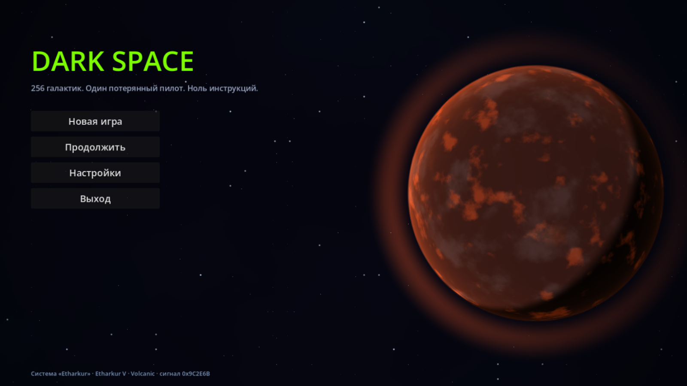

# Dark Space

[](https://github.com/dpteam/DarkSpaceGodot/actions/workflows/ci.yml)

> Космический симулятор / RPG / выживание с открытым миром, полностью сгенерированным процедурно.
> 256 галактик, алхимия ресурсов, мультиплеер, «Вселенское Православие» и очень чёрный юмор.



*Визуальный знак проекта: планета и звёздное поле на скриншоте сгенерированы процедурным шейдером меню.*

---

## О проекте

**Dark Space** — игра про потерявшего память пилота, который приходит в себя в неизученном секторе
космоса без корабля и без ответов. Единственная зацепка — обрывок сигнала с координатами,
ведущими к загадочному артефакту.

Вдохновение: **0x10c** (Notch), **Frontier: Elite II** (David Braben), **No Man's Sky** (Hello Games).

### Ключевые особенности

- 🌌 **256 галактик**, каждая — процедурно сгенерирована от сида (спиральные, эллиптические, неправильные и др.).
- 🪐 **Процедурные звёздные системы и планеты**: спектральные классы, чёрные дыры, биомы, гравитация, атмосфера, жизнь.
- 🚀 **Процедурные корабли**: корпуса, двигатели, модули, с чёрным юмором в описаниях.
- ⚗️ **Алхимическая система ресурсов**: 12–16 базовых элементов и комбинаторика уникальных веществ.
- 🛐 **Религия «Вселенское Православие»** — источник лора и сатиры.
- 🤝 **Мультиплеер**: P2P (кооп 2–4) и клиент-сервер («френдслоп»).
- 💾 **Отказоустойчивые сохранения**: авто-бэкапы, ротация, восстановление после повреждений.
- 🎨 **Никаких хардкодных ассетов**: всё генерируется процедурно (кроме базового UI и шрифтов).

### Текущее состояние

- Главное меню с процедурной планетой — текущая сильная сторона проекта.
- First-person кокпит по мотивам Elite: прицел, звёздная пыль, сканер, дашборд.
- Элитовская модель полёта по умолчанию: скорость вдоль носа, тангаж/крен, разгон и торможение.
- Геометрический масштаб систем, floating origin, процедурные станции и рынок из 17 товаров.
- Детерминированная генерация и физика, проверяемая математическими инвариантами.
- **237 unit + 13 integration tests**, сборка без предупреждений.

План переделки и следующие приоритеты — в [`ROADMAP.md`](ROADMAP.md).

---

## Требования для сборки

- **Godot 4.7.2 stable .NET / Mono** (обязательно `.NET`-сборка, обычная не подойдёт).
- **.NET 8 SDK** (для сборки C#-проекта и тестов).
- ОС: Windows / Linux / macOS (разработка ведётся на Windows).

В процессе разработки используется .NET 8. Если установлен более новый SDK (например, .NET 9),
он также способен собрать проект, нацеленный на `net8.0`, при наличии соответствующего runtime или roll-forward.

---

## Сборка и запуск

### 1. Сборка C#-проекта

```bash
dotnet build DarkSpace.sln
```

> Проект нацелен на **net8.0**. Если установлен только более новый SDK (например, .NET 9),
> он соберёт `net8.0` при наличии соответствующего рантайма или roll-forward.

### 2. Запуск в редакторе Godot

1. Открой **Godot 4.7.2 stable (.NET)**.
2. `Project → Open` → выбери `project.godot` в корне репозитория.
3. Дождись сборки C# (Godot вызовет `dotnet build` автоматически) и нажми **F5**.

> **Если работаешь по RDP:** редактор может падать при рендере Forward+ (Vulkan) —
> это проблема окружения (RDP + драйвер NVIDIA), а не проекта. Запускай редактор с
> `--rendering-method gl_compatibility`, например через `tools/open-editor.cmd`.
> Подробности — `MEMORY.md` → «Известные проблемы» (ENV-001) и `tools/README.md`.

### 3. Запуск из командной строки

```bash
# Открыть редактор
godot --path .

# Запустить игру
godot --path . -- --run
```

### 4. Тесты

```bash
dotnet test tests/UnitTests/UnitTests.csproj
dotnet test tests/IntegrationTests/IntegrationTests.csproj
```

### 5. GitHub Actions

Workflow [`CI`](.github/workflows/ci.yml) запускается для push в `main` и для pull request в `main`.
Он выполняет:

- Release-сборку всей solution;
- unit- и integration-тесты с TRX-отчётами;
- Godot 4.7.2 .NET headless import и smoke-запуск главной сцены;
- публикацию downloadable artifacts `darkspace-build-<sha>` и `test-reports-<sha>`.

Артефакты доступны во вкладке **Actions → нужный workflow run → Artifacts** и хранятся 14 дней.
`darkspace-build-<sha>` содержит сборки C# и метаданные, а не самостоятельный игровой EXE:
для запуска пока нужны исходный проект и соответствующий Godot .NET.

---

## Структура проекта

```
DarkSpace/
├── AGENT.md              # Правила работы над проектом (стиль, архитектура, Git, тесты)
├── MEMORY.md             # Долговременная память: changelog, проблемы, решения, ссылки
├── README.md             # Этот файл
├── PROMPT.md             # Исходное ТЗ (не изменять без явного указания)
├── SCENARIO.md           # Сюжет, лор, фракции, религия
├── DarkSpace.csproj      # C#-проект (Godot .NET)
├── DarkSpace.sln         # Solution со всеми проектами
├── project.godot         # Конфигурация проекта Godot
├── addons/               # Сторонние аддоны (Klotho, EasySave и т.д.)
├── assets/
│   ├── fonts/            # Минимальный набор шрифтов
│   └── shaders/          # Процедурные шейдеры
├── src/
│   ├── Core/             # Чистое ядро (DarkSpace.Core, без зависимости от Godot)
│   │   ├── Data/         # Структуры данных, сериализация
│   │   ├── Generation/   # Процедурная генерация
│   │   ├── Systems/      # Игровые системы (экономика, алхимия, фракции)
│   │   └── Utils/        # Утилиты, хелперы (PRNG, сиды, логирование)
│   ├── Gameplay/
│   │   ├── Player/       # Игрок, управление
│   │   ├── Ship/         # Корабли, модули
│   │   ├── Universe/     # Галактики, звёзды, планеты
│   │   └── NPC/          # Расы, ИИ, диалоги
│   ├── Network/
│   │   ├── Client/
│   │   ├── Server/
│   │   └── Shared/
│   └── UI/
│       ├── HUD/
│       ├── Menus/
│       └── Widgets/
└── tests/
    ├── UnitTests/        # Юнит-тесты логики (xUnit)
    └── IntegrationTests/ # Интеграционные тесты (мультиплеер)
```

Дополнительно в корне есть папка `tools/` со вспомогательными скриптами разработки
(`open-editor.cmd`, `run-game.cmd`, `build-and-test.cmd`) — см. `tools/README.md`.

Референсы Elite II и NES Elite находятся локально в `refs/`, исключены из Git и используются только
для изучения алгоритмов, интерфейса и математики: `refs/glfrontier-master`, `refs/ELITE1NES`.

---

## Документация

| Файл | Назначение |
|---|---|
| `AGENT.md` | Как работать над проектом: стиль кода, архитектура, Git, тесты, запреты |
| `MEMORY.md` | Changelog, известные проблемы, принятые решения, дизайн-заметки, ссылки |
| `SCENARIO.md` | Сюжет, лор, фракции, религия «Вселенское Православие» |
| `PROMPT.md` | Исходное ТЗ harness |
| `ROADMAP.md` | Приоритеты переделки и критерии качества |

---

## Вклад в проект

- Работаем через ветки `feature/*`, `bugfix/*`, `hotfix/*`.
- Коммиты — по **Conventional Commits** (`feat:`, `fix:`, `docs:`, ...).
- Все изменения — через **Pull Request** с описанием (что, зачем, как проверено).
- Перед PR: `dotnet build` без предупреждений, `dotnet test` — зелёный.
- Подробности — в `AGENT.md`.

---

## Лицензия

**MIT** — см. `LICENSE`.

---

## Ссылки

- Репозиторий: [dpteam/DarkSpaceGodot](https://github.com/dpteam/DarkSpaceGodot).
- Автор: **DartPower**.
- Баги и предложения: [GitHub Issues](https://github.com/dpteam/DarkSpaceGodot/issues).

## Что переделываем дальше

1. Доводим first-person полёт до цельного Elite-ощущения: манёвр, дашборд, ускорение, звук, scanner feedback.
2. Обновляем карту системы: масштаб, камера, выбор объектов, станции и маршрут к цели.
3. Добавляем процедурные текстуры планет с тем же сидом, что используется в меню.
4. Делаем посадку на планету отдельным детерминированным режимом, вдохновлённым No Man's Sky.
5. Расширяем станции/рынок, бой, гиперпрыжки и реальный сетевой транспорт.

Подробности и критерии готовности — в [`ROADMAP.md`](ROADMAP.md).

---

*«Великий Архитектор сделает бэкап твоей души. Когда-нибудь. Возможно.»*
